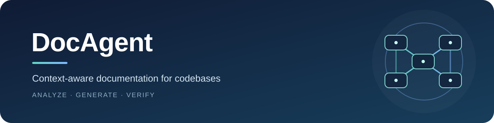
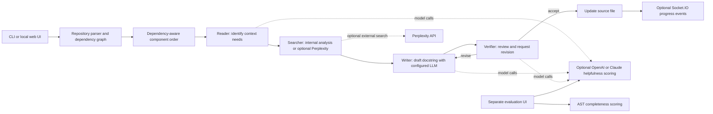

<div align="center">



# DocAgent

**Generate context-aware documentation for Python codebases with a hierarchical, multi-agent workflow.**

[](https://github.com/Attayab-31/DocAgent-with-C-support-/stargazers)
[](https://github.com/Attayab-31/DocAgent-with-C-support-)
[](https://github.com/Attayab-31/DocAgent-with-C-support-/commits/main)
[](LICENSE)

[Overview](#overview) · [Features](#features) · [Architecture](#system-architecture) · [Quickstart](#quickstart) · [CLI](#command-line-options) · [Web UI and API](#web-ui-and-api) · [Evaluation](#evaluation) · [Security and limitations](#security-and-limitations) · [Contributing](#contact-and-community)

[⭐ Star DocAgent](https://github.com/Attayab-31/DocAgent-with-C-support-/stargazers) ·
[Share on X](https://twitter.com/intent/tweet?text=DocAgent%20generates%20context-aware%20docstrings%20with%20a%20multi-agent%20workflow&url=https%3A%2F%2Fgithub.com%2FAttayab-31%2FDocAgent-with-C-support-) ·
[LinkedIn](https://www.linkedin.com/sharing/share-offsite/?url=https%3A%2F%2Fgithub.com%2FAttayab-31%2FDocAgent-with-C-support-) ·
[Facebook](https://www.facebook.com/sharer/sharer.php?u=https%3A%2F%2Fgithub.com%2FAttayab-31%2FDocAgent-with-C-support-) ·
[Reddit](https://www.reddit.com/submit?url=https%3A%2F%2Fgithub.com%2FAttayab-31%2FDocAgent-with-C-support-%2F&title=DocAgent%20-%20context-aware%20docstring%20generation) ·
[WhatsApp](https://api.whatsapp.com/send?text=DocAgent%20-%20context-aware%20docstring%20generation%3A%20https%3A%2F%2Fgithub.com%2FAttayab-31%2FDocAgent-with-C-support-)

</div>

## Overview

DocAgent analyzes source components and their dependencies, then coordinates specialized **Reader**, **Searcher**, **Writer**, and **Verifier** agents to draft and review docstrings. It can generate docstrings from the CLI or through a Flask and Socket.IO monitoring UI. The repository also contains static completeness evaluators and a separate web evaluation interface.

The generator is implemented in Python. C and C++ parsing is present as an optional path that relies on `clang` and a usable `libclang` installation; Python is the primary supported workflow. The web interfaces are local applications, not hosted demos.

## Features

- Dependency-aware processing that can document lower-level components before their callers.
- Agent workflow for gathering context, drafting, and reviewing docstrings.
- LLM adapters for Anthropic Claude, OpenAI, Google Gemini, OpenRouter, and an OpenAI-compatible local endpoint (the Hugging Face adapter uses this endpoint pattern).
- Optional external context retrieval through the Perplexity API.
- CLI controls for placeholder mode, ordering, overwriting existing docstrings, and parallel processing.
- Generation UI with live status, logs, repository structure, and completeness views.
- AST-based completeness evaluation and an optional LLM-based helpfulness evaluation UI.

## Screenshots and demo

The repository includes a system architecture illustration at [`assets/system.png`](assets/system.png):


There is no published live demo or verified runtime screenshot; the web interfaces must be run locally.

## System architecture



The generator writes accepted docstrings into the target source files. The evaluation UI runs separately; it is not an API service for the generation UI.

## Technology stack

| Area | Implementation |
| --- | --- |
| Core | Python, AST analysis, dependency graph and agent orchestration |
| LLM clients | Anthropic, OpenAI, Google Gemini, OpenRouter, OpenAI-compatible local serving |
| Generation UI | Flask, Flask-SocketIO, Eventlet, HTML/CSS/JavaScript |
| Evaluation | Python AST evaluators; Flask UI; optional OpenAI or Anthropic calls |
| Optional C/C++ parsing | Python `clang` bindings plus system `libclang` |

There is no dependency lockfile or CI workflow in this repository. `setup.py` is the package manifest. It declares Python `>=3.8`, but source files use Python 3.10 syntax, so use **Python 3.10 or newer**.

## Project structure

| Path | Purpose |
| --- | --- |
| `generate_docstrings.py` | Main CLI, processing order and source updates |
| `src/agent/` | Reader, Searcher, Writer, Verifier, orchestrator and LLM adapters |
| `src/dependency_analyzer/` | Python/C++ parsing and dependency analysis |
| `src/web/` | Generation UI, API routes and Socket.IO event handling |
| `src/evaluator/` | Completeness and helpfulness evaluators |
| `src/web_eval/` | Separate evaluation UI and parser tests |
| `config/example_config.yaml` | Safe template for local provider configuration |
| `data/raw_test_repo/` | Small example Python codebase |
| `assets/` | Architecture illustration and README banner |
| `output/dependency_graphs/` | Generated dependency graph output |

## Quickstart

### Prerequisites

- Python 3.10 or newer.
- An API key for the selected hosted LLM provider. Generation may also call Perplexity for external search when configured.
- For local-model inference, a separately managed OpenAI-compatible server. `tool/serve_local_llm.sh` is a vLLM launch example, not a turnkey install script: edit its model and GPU options for your environment.
- Optional C/C++ parsing requires the `clang` Python package and compatible system `libclang` libraries. Set `LIBCLANG_PATH` only when automatic discovery does not find the library.

### Install

Run from the repository root. The package manifest currently installs a broad dependency set, including PyTorch and web dependencies, so installation can be large.

```bash
git clone https://github.com/Attayab-31/DocAgent-with-C-support-.git
cd DocAgent-with-C-support-
python -m venv .venv
# Linux/macOS:
source .venv/bin/activate
# Windows PowerShell: .venv\Scripts\Activate.ps1
python -m pip install --upgrade pip
python -m pip install -e .
```

Create a private working configuration from the checked-in example, then edit the provider, model, and credentials:

```bash
cp config/example_config.yaml config/agent_config.yaml
```

On Windows PowerShell, use `Copy-Item config/example_config.yaml config/agent_config.yaml`. The local `config/agent_config.yaml` is ignored by Git. The example contains placeholder values only; replace them locally before normal generation.

### Try placeholder generation

Placeholder mode does not call an LLM and does not need the private configuration file. **It edits files in the target repository.** Try it on a disposable copy of the sample first:

```bash
cp -R data/raw_test_repo data/raw_test_repo_demo
python generate_docstrings.py --repo-path data/raw_test_repo_demo --test-mode placeholder
```

In PowerShell, copy the sample with `Copy-Item -Recurse data/raw_test_repo data/raw_test_repo_demo` before running the same generator command.

To generate real docstrings, configure a provider in `config/agent_config.yaml` and run:

```bash
python generate_docstrings.py --repo-path /absolute/path/to/your/repository
```

The CLI defaults to `data/raw_test_repo` and `config/agent_config.yaml`. Run `python generate_docstrings.py --help` for supported options. Existing docstrings longer than ten words are skipped unless overwrite is enabled.

## Command-line options

| Option | Behavior |
| --- | --- |
| `--repo-path PATH` | Source repository to parse and update |
| `--config-path PATH` | YAML configuration path; default is `config/agent_config.yaml` |
| `--test-mode placeholder` | Insert placeholder docstrings without initializing an LLM |
| `--test-mode context_print` | Print context during generation; requires normal configuration |
| `--order-mode topo\|random_node\|random_file` | Choose dependency order or randomized component/file order |
| `--overwrite-docstrings` | Replace existing docstrings, including non-empty ones |
| `--parallel` | Process independent components in parallel |
| `--max-workers N` | Set parallel worker count |
| `--enable-web` | Enable generation UI progress integration |

## Web UI and API

Launch the generation interface from the repository root:

```bash
python run_web_ui.py --host 127.0.0.1 --port 5000
```

Open <http://127.0.0.1:5000>. Use a loopback address for local use; exposing this development server to a network is not recommended because the UI has no user authentication and accepts repository paths and LLM credentials.

The Flask API uses JSON. The generation interface exposes these routes:

| Method and path | Request | Response |
| --- | --- | --- |
| `GET /api/default_config` | None | Configuration object loaded from `config/agent_config.yaml`, or built-in defaults if the file is absent |
| `POST /api/test_api` | `{"llm_type":"claude","api_key":"…","model":"…"}` (`llm_type` also accepts `openai`) | `{"status":"success","message":"…","model_response":"…"}` or `{"status":"error","message":"…"}`. The route supports Claude and OpenAI only. |
| `POST /api/start` | `{"repo_path":"/absolute/path","config":{...}}` | `{"status":"success","message":"Generation started"}` or an error object |
| `POST /api/stop` | None | Success or error status/message object |
| `GET /api/status` | None | `{"is_running":true,"repo_path":"…"}`; `is_running` is false while idle |
| `GET /api/completeness` | None | Completeness result object for the selected repository, or an error object |

`POST /api/start` saves the supplied configuration to a temporary YAML file and starts `generate_docstrings.py` as a subprocess. Route behavior and field names are based on the current Flask implementation; the API does not define a separate versioned schema.

## Evaluation

The static completeness evaluators inspect Python ASTs for docstring sections such as summaries, parameters, return values, exceptions, attributes, and examples. Some section requirements are conditional on the analyzed code. The separate web app can ask OpenAI or Claude to score selected docstring components for helpfulness.

Start the evaluation app from the repository root:

```bash
python src/web_eval/app.py --host 127.0.0.1 --port 5000
```

Then open <http://127.0.0.1:5000>. This app defaults to `0.0.0.0:5000`; set an explicit loopback host for local-only use. It uses the same port as the generation UI by default, so do not run both on that port simultaneously.

## Testing and build

The repository contains `src/web_eval/test_docstring_parser.py` and declares pytest in the `dev` extra. The documented test command is:

```bash
python -m pip install -e ".[dev]"
python -m pytest
```

No CI workflow or published test results are present. No separate frontend build step or lockfile is defined.

## Security and limitations

- Keep API credentials in your ignored `config/agent_config.yaml`; do not commit credentials or paste them into issues. The web UI writes configuration submitted by its browser to a temporary YAML file.
- Both Flask applications use hard-coded development secret keys and have no authentication; the generation UI also allows Socket.IO connections from any origin. Treat them as local development tools, not production services.
- The generator modifies source files in place. Review a diff or work on a clean copy/branch before processing important repositories.
- LLM and external-search calls send code context to the configured provider. Check provider terms and data-handling rules before using private code.
- C/C++ support depends on the local libclang toolchain and is less turnkey than the Python workflow.
- The evaluator's helpfulness scores depend on model responses; they are subjective feedback, not a formal quality guarantee.
- No `.env` interface, dependency lockfile, release, CI workflow, or security-scanning workflow is currently provided.

## Roadmap

The repository does not publish a formal roadmap. Useful follow-up work would include correcting package metadata to Python 3.10+, reducing or separating heavyweight dependencies, adding reproducible dependency locking, and hardening the local web interfaces before any remote deployment.

## License and citation

This repository retains its existing **MIT License**; see [`LICENSE`](LICENSE). The source contains Meta copyright notices, which remain intact.

If you use the research system, cite the paper:

```bibtex
@misc{yang2025docagent,
  title={DocAgent: A Multi-Agent System for Automated Code Documentation Generation},
  author={Dayu Yang and Antoine Simoulin and Xin Qian and Xiaoyi Liu and Yuwei Cao and Zhaopu Teng and Grey Yang},
  year={2025},
  eprint={2504.08725},
  archivePrefix={arXiv},
  primaryClass={cs.SE}
}
```

Paper: <https://arxiv.org/abs/2504.08725>.

## Contact and community

- WhatsApp: [+92 317 4026038](https://api.whatsapp.com/send?phone=923174026038)
- Email: [attayabpc2@gmail.com](mailto:attayabpc2@gmail.com)
- LinkedIn: [Muhammad Attayab Ashraf](https://pk.linkedin.com/in/muhammad-attayab-ashraf-519562262)
- Freelancer: [MuhammadAttayab](https://www.freelancer.com/u/MuhammadAttayab)
- Issues and feature requests: [GitHub Issues](https://github.com/Attayab-31/DocAgent-with-C-support-/issues)
- Source and contributions: [Repository](https://github.com/Attayab-31/DocAgent-with-C-support-) · [Contributing guide](CONTRIBUTING.md)
- Support the project: [⭐ Star DocAgent](https://github.com/Attayab-31/DocAgent-with-C-support-/stargazers)

<details>
<summary>Related project documentation</summary>

- [Agent framework](src/agent/README.md)
- [Generation web interface](src/web/README.md)
- [Evaluation interface](src/web_eval/README.md)
- [Evaluator notes](src/evaluator/README.md)
- [Installation notes](INSTALL.md)
- [Changelog](CHANGELOG.md)
- [Code of Conduct](CODE_OF_CONDUCT.md)

</details>
